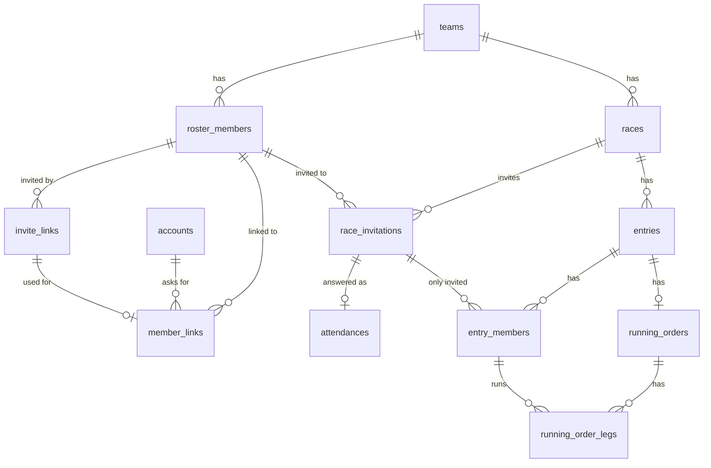

# MVP database design

- Status: Draft
- Issue: #60, #65, #68
- Related: ADR-0002 (PostgreSQL and MongoDB), ADR-0005 (multi-tenant data), ADR-0006 (access policy), ADR-0008 (accounts and roster members), `docs/design/screens.md`

This document describes the data tasuki's MVP stores and the rules it follows. Column types, keys, and indexes are decided by the maintainer before implementation.

## Business rules

### Races

- An organizer registers a race with a **name** and a **description**.
- The description is one field that holds text, lists, and numbers: the race type (distance-based or time-based), the race date, free text, the distance of each leg (km), the distance of one lap (km), the time limit (minutes), the deadline, and the target time.
  - Distance-based races have leg distances. Time-based races have a time limit and a lap distance.
  - Units are fixed: distances in km (e.g. `30.5`), time limits in minutes (e.g. `180`).
- Races are not deleted or cancelled in the app. Cancellations are announced on LINE.

### Invitations to a race and attendance

- An organizer invites members to each race in the app, and can cancel an invitation. Cancelling removes the member from attendance, the entry, and the running order (with the effects described under Running order).
- Only invited members answer attendance: **attending**, **not attending**, or **undecided**.
  - They can switch between attending and undecided at any time.
  - **Not attending** is final for the member: they no longer see the race and cannot change the answer.
  - A member who changes their answer away from attending is removed from the entry and the running order.
- Organizers cannot answer for a member.
- Attendance is per race. An organizer creates an entry with a name (for example "Team A") and adds members who answered attending. The MVP allows one entry per race, but the tables allow several.
- Removing a member from the entry also removes them from the running order.

### Running order

- A running order is a list of legs: which roster member runs which leg.
  - Distance-based: one leg per leg distance in the description. Time-based: the organizer adds and removes legs freely.
  - Runners are picked from the entry's members. One member can run any number of legs.
- A running order is a draft until an organizer confirms it. It can be confirmed only when every leg has a runner. Members who answered attending see it only after it is confirmed.
- After it is confirmed, only organizers can change it. Changes are shown right away and it stays confirmed.
- A leg can become empty after confirming (cancelled invitation, removal from the entry, a changed answer, or a member marked as left). It stays confirmed; the empty leg is shown as not decided.
- When a runner is removed from a confirmed running order, their lap times for that race are deleted and their average time is recalculated.
- Every change is kept as history. The MVP has no screen to view it.

### Lap times and average time

- Members submit their own lap times per race, as time per km (`MM:SS`), only for races where they are a runner in the confirmed running order.
- Members can edit and delete their own lap times. Nobody else can change them; organizers can view them.
- Each roster member has an **average time** (per km) and a **lap count**.

| Laps submitted | Average time |
| --- | --- |
| 0 | `3:40` (default; not counted as a lap) |
| 1 | That lap |
| 2 or more | The mean of all laps |

- When new laps are submitted, the average is recalculated from the stored average and lap count:
  `new average = (average × lap count + sum of new laps) ÷ (lap count + number of new laps)`
  - Example: 5 laps averaging `3:30`, then `3:20`, `3:25`, `3:25` → (3:30 × 5 + 3:20 + 3:25 + 3:25) ÷ 8 = 3:27.5 → `3:28`
- When a lap is edited or deleted (by the member, or because the runner was removed from the running order), the average and lap count are recalculated from all of the member's remaining laps.
- Times are stored and shown as `MM:SS`. Fractions of a second are rounded half up.
- The profile shows the average time. Members enter nothing in the profile.

### Predictions

| Race | Prediction | Calculation |
| --- | --- | --- |
| Distance-based | Total time | For each runner: average time × the total distance of the legs they run. Sum over all runners |
| Time-based | Number of laps | Time limit ÷ the mean of the average times of the runners in the running order = distance (km). Distance ÷ lap distance, rounded down to whole laps |

- Example (time-based): 180 min ÷ `3:30`/km ≈ 51.4 km; with 2 km laps → 25 laps.
- Empty legs are left out of the prediction, and the prediction says that some legs are empty.
- Predictions are estimates and may differ from the result.

### Roster and members

- Only organizers add people to the roster. A roster member has a name only (plus the average time and lap count above). Names cannot be changed.
- Organizers can mark a roster member as left. Left members cannot log in and are shown as left. Their data is kept.
  - Invitations to races dated today or later are cancelled automatically, with the same effects as cancelling by hand. Past races are not changed.
  - Organizers can undo left. Cancelled invitations do not come back.
- Organizers can unlink an approved account from a roster member (for example when someone changes their LINE account).

### Invite links (joining the team)

- An organizer creates a personal invite link for a roster member. It is valid for one week and can be used once.
- Links cannot be created for roster members who already have an approved account or who have left.
- Creating a new link for the same roster member makes the old one unusable.
- The person logs in with LINE through the link, and an organizer approves or rejects the link between the account and the roster member. Rejected people see that they were rejected; the reason is told outside the app. Applying again is low priority.
- Organizers who also run link their own account the same way, and may approve it themselves.

### Who sees what

| Data | Organizers | Members who answered attending | Invited members (not answered / undecided) | Other members |
| --- | --- | --- | --- | --- |
| Race name | Yes | Yes | Yes | No |
| Race description (except the deadline) | Yes | Yes | Yes | No |
| Deadline (inside the description) | Yes | No | No | No |
| Attendance answers | Yes | Own only | Own only | No |
| Running order draft | Yes | No | No | No |
| Confirmed running order and prediction | Yes | Yes | No | No |
| Lap times, average time | Everyone's | Own only | Own only | Own only |

"Other members" includes members who answered not attending. The API removes the parts a user may not see. See ADR-0006.

## PostgreSQL tables

Every team-owned table belongs to a team (ADR-0005).

| Table | Main fields |
| --- | --- |
| `teams` | The team (tenant) |
| `accounts` | LINE user ID, display name |
| `roster_members` | Team, name, left or not, average time (`MM:SS`), lap count |
| `invite_links` | Roster member, token, expiry (one week), when it was used or made unusable |
| `member_links` | Account, roster member, approved (pending / approved / rejected), unlinked |
| `races` | Team, name, description (JSON: race type, race date, text, leg distances in km, lap distance in km, time limit in minutes, deadline, target time) |
| `race_invitations` | Race, roster member (invited) |
| `attendances` | Race, roster member, status (attending / not attending / undecided) |
| `entries` | Race, entry name (one per race in the MVP) |
| `entry_members` | Entry, roster member (how attending members are split into entries) |
| `running_orders` | Entry, status (draft / confirmed) |
| `running_order_legs` | Running order, leg number, roster member |

## MongoDB collections

MongoDB refers to PostgreSQL IDs and does not copy data (ADR-0002).

| Collection | Contents |
| --- | --- |
| `lap_records` | Race, roster member, lap times per km (`MM:SS`) |
| `running_order_history` | A snapshot of the running order at each change, who changed it, when |

The average time and lap count are written back to `roster_members` in PostgreSQL when laps are submitted, edited, or deleted (ADR-0002).

## Schema (draft, #68)

Status: draft written by Claude from the ADRs and the rules above, for the maintainer to review. Migrations use golang-migrate (#20, #21).

### Conventions

| Topic | Draft |
| --- | --- |
| IDs | `uuid`, generated by the application (UUIDv7, so new rows sort by time). Entity factories assign the ID (ADR-0011) |
| Times (`MM:SS`) | Whole seconds as `integer` (e.g. `3:28` → `208`). Converted to `MM:SS` only for display |
| Race description | `jsonb` |
| Timestamps | `timestamptz` |
| States | `text` with a `CHECK` constraint |
| Requires | PostgreSQL 15 or later (`ON DELETE SET NULL (column)`) |
| Cancelled invitations | Deleted. Attendance, entry membership, and legs follow by foreign keys |
| Link states | Booleans, not a status column. `member_links.approved`: `NULL` = pending, `true` = approved, `false` = rejected |
| Unlinked accounts | Kept, with `unlinked = true`; `approved` stays `true` |
| Invite links | Renamed from `invitations` to `invite_links`, so they are not confused with `race_invitations` |

### Relations



- `accounts` do not belong to a team; `roster_members` do (ADR-0005, ADR-0008).
- `entry_members` refers to `race_invitations`, so cancelling an invitation removes the member from the entry by `ON DELETE CASCADE`.
- `running_order_legs` refers to `entry_members`, so removing a member from the entry empties their legs by `ON DELETE SET NULL (roster_member_id)`.
- Attendance changed away from "attending" is not a foreign key; the use case removes the entry membership (`docs/design/api.md`).
- Lap records in MongoDB are deleted by the use case; there are no foreign keys across the databases (ADR-0002).

### Tables

```sql
CREATE TABLE teams (
  id         uuid PRIMARY KEY,
  name       text NOT NULL,
  created_at timestamptz NOT NULL DEFAULT now()
);

CREATE TABLE accounts (
  id           uuid PRIMARY KEY,
  line_user_id text NOT NULL UNIQUE,
  display_name text NOT NULL,
  created_at   timestamptz NOT NULL DEFAULT now(),
  updated_at   timestamptz NOT NULL DEFAULT now()
);

CREATE TABLE roster_members (
  id              uuid PRIMARY KEY,
  team_id         uuid NOT NULL REFERENCES teams (id),
  name            text NOT NULL CHECK (name <> ''),
  left_at         timestamptz,                         -- NULL = not left
  average_seconds integer NOT NULL DEFAULT 220 CHECK (average_seconds > 0),  -- 3:40
  lap_count       integer NOT NULL DEFAULT 0 CHECK (lap_count >= 0),
  created_at      timestamptz NOT NULL DEFAULT now(),
  updated_at      timestamptz NOT NULL DEFAULT now()
);
CREATE INDEX roster_members_team_id ON roster_members (team_id);

CREATE TABLE invite_links (
  id               uuid PRIMARY KEY,
  roster_member_id uuid NOT NULL REFERENCES roster_members (id),
  token_hash       bytea NOT NULL UNIQUE,              -- SHA-256 of the token; the token itself is not stored
  expires_at       timestamptz NOT NULL,
  used_at          timestamptz,
  revoked_at       timestamptz,                        -- set when a newer link replaces it
  created_at       timestamptz NOT NULL DEFAULT now()
);
-- At most one link per roster member that is neither used nor replaced.
CREATE UNIQUE INDEX invite_links_one_open ON invite_links (roster_member_id)
  WHERE used_at IS NULL AND revoked_at IS NULL;

CREATE TABLE member_links (
  id               uuid PRIMARY KEY,
  account_id       uuid NOT NULL REFERENCES accounts (id),
  roster_member_id uuid NOT NULL REFERENCES roster_members (id),
  invite_link_id   uuid NOT NULL UNIQUE REFERENCES invite_links (id),  -- an invite link is used once
  approved         boolean,                            -- NULL = pending, true = approved, false = rejected
  unlinked         boolean NOT NULL DEFAULT false,
  decided_at       timestamptz,                        -- when it was approved or rejected
  created_at       timestamptz NOT NULL DEFAULT now(),
  CHECK (NOT unlinked OR approved IS TRUE),            -- only approved links are unlinked
  CHECK ((approved IS NULL) = (decided_at IS NULL))
);
-- One approved account per roster member, and one roster member per account (ADR-0008).
CREATE UNIQUE INDEX member_links_one_approved_per_member  ON member_links (roster_member_id) WHERE approved AND NOT unlinked;
CREATE UNIQUE INDEX member_links_one_approved_per_account ON member_links (account_id)       WHERE approved AND NOT unlinked;
-- No new invite link while a link is pending; an account waits for one roster member at a time.
CREATE UNIQUE INDEX member_links_one_pending_per_member   ON member_links (roster_member_id) WHERE approved IS NULL;
CREATE UNIQUE INDEX member_links_one_pending_per_account  ON member_links (account_id)       WHERE approved IS NULL;

CREATE TABLE races (
  id          uuid PRIMARY KEY,
  team_id     uuid NOT NULL REFERENCES teams (id),
  name        text NOT NULL CHECK (name <> ''),
  description jsonb NOT NULL,                          -- validated by the RaceDescription value object
  version     integer NOT NULL DEFAULT 0,
  created_at  timestamptz NOT NULL DEFAULT now(),      -- R1 sorts by this, newest first
  updated_at  timestamptz NOT NULL DEFAULT now()
);
CREATE INDEX races_team_id_created_at ON races (team_id, created_at DESC);
-- Marking a member as left looks for races dated today or later.
CREATE INDEX races_team_id_race_date ON races (team_id, ((description ->> 'race_date')));

CREATE TABLE race_invitations (
  race_id          uuid NOT NULL REFERENCES races (id),
  roster_member_id uuid NOT NULL REFERENCES roster_members (id),
  created_at       timestamptz NOT NULL DEFAULT now(),
  PRIMARY KEY (race_id, roster_member_id)
);
CREATE INDEX race_invitations_roster_member_id ON race_invitations (roster_member_id);

CREATE TABLE attendances (
  race_id          uuid NOT NULL,
  roster_member_id uuid NOT NULL,
  status           text NOT NULL CHECK (status IN ('attending', 'not_attending', 'undecided')),
  updated_at       timestamptz NOT NULL DEFAULT now(),
  PRIMARY KEY (race_id, roster_member_id),
  FOREIGN KEY (race_id, roster_member_id) REFERENCES race_invitations ON DELETE CASCADE
);

CREATE TABLE entries (
  id         uuid PRIMARY KEY,
  race_id    uuid NOT NULL REFERENCES races (id),
  name       text NOT NULL CHECK (name <> ''),
  created_at timestamptz NOT NULL DEFAULT now(),
  UNIQUE (id, race_id)                                 -- target of the composite key below
);
CREATE INDEX entries_race_id ON entries (race_id);

CREATE TABLE entry_members (
  entry_id         uuid NOT NULL,
  race_id          uuid NOT NULL,
  roster_member_id uuid NOT NULL,
  created_at       timestamptz NOT NULL DEFAULT now(),
  PRIMARY KEY (entry_id, roster_member_id),
  FOREIGN KEY (entry_id, race_id) REFERENCES entries (id, race_id),
  FOREIGN KEY (race_id, roster_member_id) REFERENCES race_invitations ON DELETE CASCADE
);

CREATE TABLE running_orders (
  id           uuid PRIMARY KEY,
  entry_id     uuid NOT NULL UNIQUE REFERENCES entries (id),   -- one running order per entry
  status       text NOT NULL CHECK (status IN ('draft', 'confirmed')),
  version      integer NOT NULL DEFAULT 0,
  confirmed_at timestamptz,
  created_at   timestamptz NOT NULL DEFAULT now(),
  updated_at   timestamptz NOT NULL DEFAULT now(),
  UNIQUE (id, entry_id)
);

CREATE TABLE running_order_legs (
  running_order_id uuid NOT NULL,
  entry_id         uuid NOT NULL,
  leg_number       integer NOT NULL CHECK (leg_number > 0),
  roster_member_id uuid,                               -- NULL = empty leg
  PRIMARY KEY (running_order_id, leg_number),
  FOREIGN KEY (running_order_id, entry_id) REFERENCES running_orders (id, entry_id) ON DELETE CASCADE,
  FOREIGN KEY (entry_id, roster_member_id) REFERENCES entry_members (entry_id, roster_member_id)
    ON DELETE SET NULL (roster_member_id)
);
CREATE INDEX running_order_legs_runner ON running_order_legs (entry_id, roster_member_id);
```

### MongoDB collections

```
lap_records
{
  _id:              ObjectId,
  race_id:          UUID,            // races.id
  roster_member_id: UUID,            // roster_members.id
  laps: [ { lap_id: UUID, seconds: int, submitted_at: Date } ],   // in submission order
  updated_at:       Date
}
unique index { race_id: 1, roster_member_id: 1 }
index        { roster_member_id: 1 }                 // M2: laps by race

running_order_history
{
  _id:                   ObjectId,
  running_order_id:      UUID,       // running_orders.id
  race_id:               UUID,
  entry_id:              UUID,
  changed_by_account_id: UUID,       // accounts.id
  changed_at:            Date,
  status:                "draft" | "confirmed",
  legs: [ { leg_number: int, roster_member_id: UUID | null } ]
}
index { running_order_id: 1, changed_at: -1 }
```

### Not in this draft

- Storage for login tokens, one-time codes, and the LINE Login state (#84; ADR-0007 leaves session storage to the implementation)
- Composite keys that also check that two rows belong to the same team (for example a race invitation whose race and roster member are in different teams). In the single-team MVP the application checks this

---

<details>
<summary>日本語</summary>

# MVP のデータベースの設計

- Status: Draft
- Issue: #60, #65, #68
- 関連：ADR-0002（PostgreSQL と MongoDB）、ADR-0005（マルチテナントのデータ）、ADR-0006（アクセスの方針）、ADR-0008（アカウントと名簿のメンバー）、`docs/design/screens.md`

tasuki の MVP が保存するデータと、そのルールを書く。列の型、キー、インデックスは、実装の前にメンテナーが決める。

## 業務のルール

### 大会

- 幹事が、**大会名**と**説明欄**で大会を登録する
- 説明欄は1つの欄で、文章、配列、数値が入る。大会の種別（距離制／時間制）、開催日、自由な文章、区ごとの距離（km）、1周の距離（km）、制限時間（分）、締め切り、目標タイム
  - 距離制の大会は区ごとの距離を持つ。時間制の大会は制限時間と1周の距離を持つ
  - 単位は固定。距離は km（例：`30.5`）、制限時間は分（例：`180`）
- 大会の削除や中止はアプリでは行わない。中止は LINE で連絡する

### 大会への招待と出欠

- 幹事が、アプリの中で大会ごとにメンバーを誘う。招待は取り消せる。取り消すと、そのメンバーは出欠、エントリー、走順からも外れる（走順で起きることは「走順」に書く）
- 出欠を答えられるのは誘われたメンバーだけ。**参加**、**不参加**、**保留**のどれか
  - 参加と保留の間は、いつでも変えられる
  - **不参加**はメンバーにとって最後の回答。その大会は見られなくなり、回答も変えられない
  - 参加から回答を変えたメンバーは、エントリーと走順から外れる
- 幹事がメンバーの代わりに回答することはできない
- 出欠は大会ごと。幹事が名前（例：「A チーム」）を付けてエントリーを作り、参加と答えたメンバーを入れる。MVP ではエントリーは大会ごとに1つだが、テーブルは複数に対応する
- エントリーから外したメンバーは、走順からも外れる

### 走順

- 走順は区の並びで、どの区を名簿の誰が走るか
  - 距離制：説明欄の区ごとの距離と同じ数の区。時間制：幹事が区を自由に足したり消したりする
  - 走者はエントリーのメンバーから選ぶ。1人が何区でも走れる
- 幹事が確定するまで、走順は下書き。すべての区に走者がいるときだけ確定できる。参加と答えたメンバーは、確定した後に見られる
- 確定した後に直せるのは幹事だけ。直すとすぐ見え、確定のまま
- 確定した後に区が空くことがある（招待の取り消し、エントリーから外す、回答の変更、退会）。確定のままで、空いた区は未定と表示する
- 確定した走順から走者が外れると、その大会のその人のラップタイムは消え、平均タイムは計算し直される
- 変更はすべて履歴に残す。MVP には履歴を見る画面はない

### ラップタイムと平均タイム

- メンバーは、大会ごとに自分のラップタイムを 1km あたりのタイム（`MM:SS`）で提出する。提出できるのは、自分が確定した走順の走者になっている大会だけ
- メンバーは自分のラップタイムを直したり消したりできる。ほかの人は変えられない。幹事は見られる
- 名簿のメンバーは、**平均タイム**（1km あたり）と**ラップ数**を持つ

| 提出したラップの数 | 平均タイム |
| --- | --- |
| 0回 | `3:40`（デフォルト値。ラップとしては数えない） |
| 1回 | そのラップ |
| 2回以上 | すべてのラップの平均 |

- 新しいラップが提出されたら、保存している平均タイムとラップ数から計算し直す
  `新しい平均 = (平均 × ラップ数 + 新しいラップの合計) ÷ (ラップ数 + 新しいラップの数)`
  - 例：5回で平均 `3:30` の人が `3:20`、`3:25`、`3:25` を出した → (3:30 × 5 + 3:20 + 3:25 + 3:25) ÷ 8 = 3:27.5 → `3:28`
- ラップが直されたり消されたりしたとき（本人の操作、または走順から外れたとき）は、その人の残っているすべてのラップから、平均タイムとラップ数を計算し直す
- タイムは `MM:SS` で保存し、表示する。秒の端数は四捨五入する
- プロフィールには平均タイムを表示する。メンバーがプロフィールに入力するものはない

### 予想

| 大会 | 予想するもの | 計算 |
| --- | --- | --- |
| 距離制 | 合計タイム | 走る人ごとに、平均タイム × その人が走る区の距離の合計。全員分を足す |
| 時間制 | 周回数 | 制限時間 ÷ 走順に入っている人の平均タイムの平均 = 距離（km）。距離 ÷ 1周の距離を、切り捨てて整数の周回数にする |

- 例（時間制）：180分 ÷ `3:30`/km ≈ 51.4km。1周 2km なら 25周
- 空いた区は予想から除き、空きの区があることを示す
- 予想なので、結果と前後することがある

### 名簿とメンバー

- 名簿に人を追加するのは幹事だけ。名簿のメンバーが持つのは名前だけ（と、上の平均タイムとラップ数）。名前は変えられない
- 幹事は名簿のメンバーを退会にできる。退会したメンバーはログインできず、退会と表示される。データは残す
  - 開催日が今日以降の大会への招待は自動で取り消され、手で取り消したときと同じことが起きる。過去の大会は変えない
  - 幹事は退会を取り消せる。取り消された招待は戻らない
- 幹事は、承認済みのアカウントと名簿のメンバーの紐付けを解除できる（LINE のアカウントを変えた人など）

### 招待リンク（チームへの参加）

- 幹事が、名簿のメンバーごとに個人の招待リンクを作る。期限は1週間で、使えるのは1回だけ
- 承認済みのアカウントがあるメンバーと、退会したメンバーには作れない
- 同じメンバーに新しいリンクを作ると、古いリンクは使えなくなる
- 本人がリンクから LINE でログインし、アカウントと名簿のメンバーの紐付けを幹事が承認または却下する。却下された人には却下されたことを表示する。理由はアプリの外で伝える。再申請は優先度が低い
- 走る幹事も同じ手順で自分のアカウントを紐付け、自分で承認してよい

### 誰が何を見られるか

| データ | 幹事 | 参加と答えたメンバー | 誘われたメンバー（未回答／保留） | ほかのメンバー |
| --- | --- | --- | --- | --- |
| 大会名 | 見られる | 見られる | 見られる | 見られない |
| 大会の説明欄（締め切りを除く） | 見られる | 見られる | 見られる | 見られない |
| 締め切り（説明欄の中） | 見られる | 見られない | 見られない | 見られない |
| 出欠の回答 | 見られる | 自分の分だけ | 自分の分だけ | 見られない |
| 走順の下書き | 見られる | 見られない | 見られない | 見られない |
| 確定した走順と予想 | 見られる | 見られる | 見られない | 見られない |
| ラップタイム、平均タイム | 全員の分 | 自分の分だけ | 自分の分だけ | 自分の分だけ |

「ほかのメンバー」には、不参加と答えたメンバーも含む。見てはいけない部分は API が取り除く。ADR-0006 を参照。

## PostgreSQL のテーブル

チームが持つテーブルは、すべてチームに属する（ADR-0005）。

| テーブル | 主な項目 |
| --- | --- |
| `teams` | チーム（テナント） |
| `accounts` | LINE のユーザー ID、表示名 |
| `roster_members` | チーム、名前、退会したかどうか、平均タイム（`MM:SS`）、ラップ数 |
| `invite_links` | 名簿のメンバー、トークン、期限（1週間）、使った日時または使えなくした日時 |
| `member_links` | アカウント、名簿のメンバー、承認（承認待ち／承認／却下）、解除 |
| `races` | チーム、大会名、説明欄（JSON：大会の種別、開催日、文章、区ごとの距離 km、1周の距離 km、制限時間 分、締め切り、目標タイム） |
| `race_invitations` | 大会、名簿のメンバー（誘われた人） |
| `attendances` | 大会、名簿のメンバー、状態（参加／不参加／保留） |
| `entries` | 大会、エントリー名（MVP では大会ごとに1つ） |
| `entry_members` | エントリー、名簿のメンバー（参加するメンバーをエントリーに分ける） |
| `running_orders` | エントリー、状態（下書き／確定） |
| `running_order_legs` | 走順、区の番号、名簿のメンバー |

## MongoDB のコレクション

MongoDB は PostgreSQL の ID を参照するだけで、データを複製しない（ADR-0002）。

| コレクション | 中身 |
| --- | --- |
| `lap_records` | 大会、名簿のメンバー、1km あたりのラップタイム（`MM:SS`） |
| `running_order_history` | 変更のたびの走順のスナップショット、変更した人、日時 |

ラップが提出、修正、削除されたら、平均タイムとラップ数を PostgreSQL の `roster_members` に書き戻す（ADR-0002）。

## スキーマ（草案、#68）

状態：ADR と上のルールから Claude が書いた草案。メンテナーがレビューする。マイグレーションは golang-migrate を使う（#20、#21）。SQL と MongoDB の形は英語の節を参照。

### 決まりごと

| 項目 | 草案 |
| --- | --- |
| ID | `uuid`。アプリケーションが作る（UUIDv7。新しい行が時間順に並ぶ）。ID はエンティティのファクトリーが付ける（ADR-0011） |
| タイム（`MM:SS`） | 秒の整数（`integer`）で持つ（例：`3:28` → `208`）。`MM:SS` にするのは表示のときだけ |
| 大会の説明欄 | `jsonb` |
| 日時 | `timestamptz` |
| 状態 | `CHECK` 制約付きの `text` |
| 必要なもの | PostgreSQL 15 以上（`ON DELETE SET NULL (列)` を使うため） |
| 取り消した招待 | 消す。出欠、エントリーのメンバー、区は外部キーで連動する |
| 紐付けの状態 | 状態の列ではなく bool で持つ。`member_links.approved`：`NULL` = 承認待ち、`true` = 承認、`false` = 却下 |
| 解除した紐付け | 残す。`unlinked = true` にする。`approved` は `true` のまま |
| 招待リンク | `race_invitations` と紛らわしくないよう、`invitations` を `invite_links` に名前を変える |

### リレーション

- `accounts` はチームに属さず、`roster_members` はチームに属する（ADR-0005、ADR-0008）
- `entry_members` は `race_invitations` を参照する。招待を取り消すと、`ON DELETE CASCADE` でエントリーから外れる
- `running_order_legs` は `entry_members` を参照する。エントリーから外すと、`ON DELETE SET NULL (roster_member_id)` でその人の区が空く
- 出欠を「参加」から変えたときは外部キーではなく、ユースケースがエントリーから外す（`docs/design/api.md`）
- MongoDB のラップの記録はユースケースが消す。データベースをまたぐ外部キーはない（ADR-0002）

### この草案に入れていないもの

- ログインのトークン、一度きりのコード、LINE ログインの state の保存（#84。ADR-0007 でセッションの保存方法は実装のときに決めるとした）
- 2つの行が同じチームに属することまで確かめる複合キー（例：大会と名簿のメンバーが違うチームの招待）。1チームの MVP では、アプリケーションが確かめる

</details>
